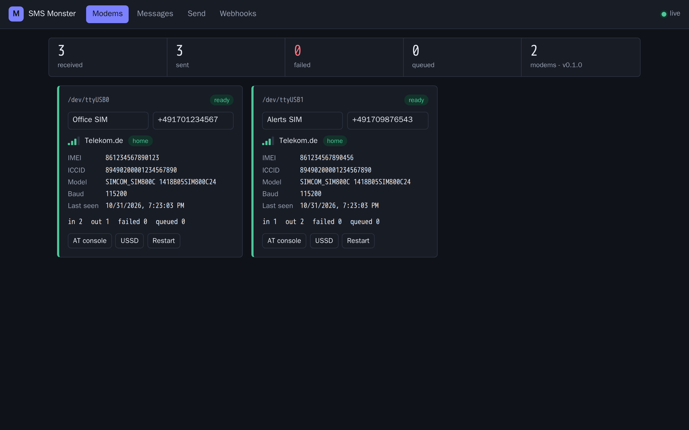
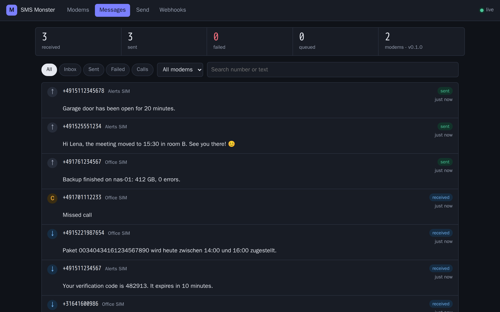
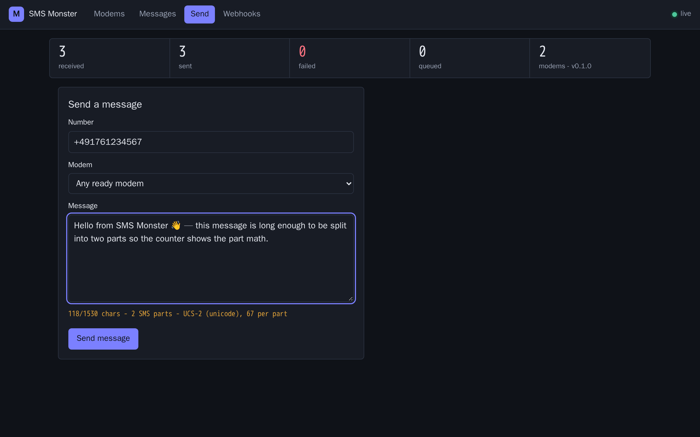
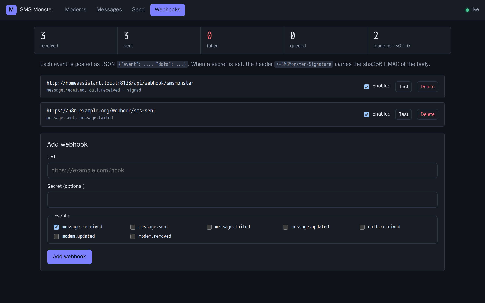
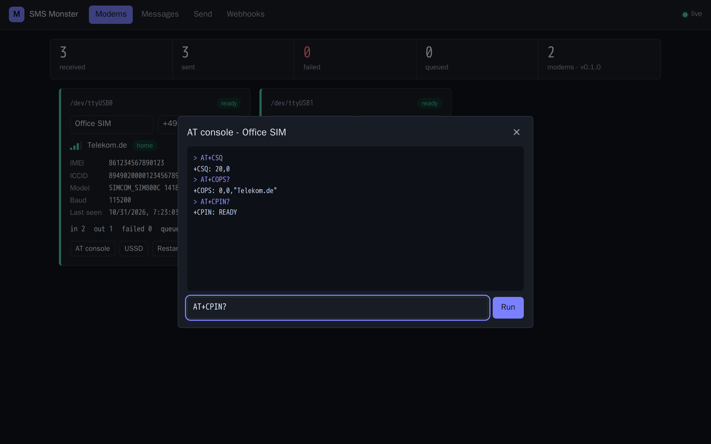
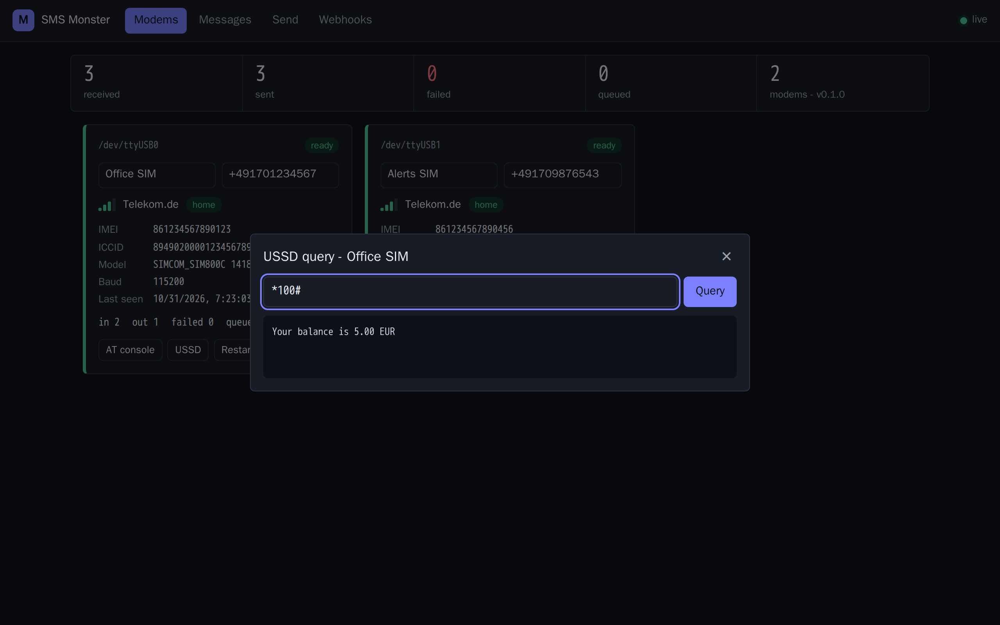

<p align="center"></p>

Self-hosted SMS gateway for small in-network setups. Plug one or more **SIM800C** USB modems into a Raspberry Pi
(or any Linux box), run one container, and you get:

- a web UI to read, send and search SMS across all modems (live updates, no polling)
- a JSON REST API with optional token auth
- webhooks for incoming SMS, sent/failed messages, incoming calls and modem status (HMAC signed)
- full PDU mode: GSM-7 and Unicode (UCS-2), long/concatenated messages in both directions, alphanumeric senders
- per-modem status: signal, operator, registration, IMEI/ICCID, SIM PIN handling, USSD queries (prepaid balance), raw AT console
- hot-plug: modems are discovered when connected and reconnected after a power dip; serial ports that are not modems can be ignored from the UI
- a **Home Assistant add-on** (Ingress UI, `uart` access), published from `addon/` to a separate add-on repository

Everything is pure Python (no compiled wheels) so it builds on armv7/arm64/amd64 alike.

## Screenshots

Taken from the built-in demo (`python tests/demo_server.py`, two simulated modems, no hardware).

| Modems | Messages |
|---|---|
|  |  |

| Send | Webhooks |
|---|---|
|  |  |

| AT console | USSD query |
|---|---|
|  |  |

The UI follows the system colour scheme ([light mode](docs/screenshots/messages-light.png)) and works on phones
([mobile view](docs/screenshots/mobile-modems.png)).

## Hardware notes

- Each SIM800C module needs its own USB-serial converter (most breakouts have a CH340 or CP2102 on board).
- Power: SIM800 draws up to 2 A in bursts. Use a good 5 V supply / powered hub, otherwise you will see
  `UNDER-VOLTAGE` warnings and random reconnects.
- The SIM800C autobauds on the first `AT`. SMS Monster probes 115200 first, then 9600 (configurable).
- Disable the SIM PIN, or set `SMSMONSTER_SIM_PIN`.

## Run with Docker Compose (standalone)

```sh
docker compose up -d --build
```

Open `http://<host>:8080`. Edit `docker-compose.yml` to map your modems (`/dev/ttyUSB0`, …) or use the
`device_cgroup_rules` variant shown there for hot-plug of any USB serial adapter.
Data (SQLite) lives in `./data`.

### Configuration (environment variables)

| Variable | Default | Meaning |
|---|---|---|
| `SMSMONSTER_DEVICES` | `auto` | `auto` = scan `/dev/serial/by-id`, `/dev/ttyUSB*`, `/dev/ttyACM*`; or comma separated paths / pyserial URLs (`socket://host:5555`, `rfc2217://host:port`) |
| `SMSMONSTER_BAUDRATES` | `115200,9600,57600,38400` | Baud rates to probe |
| `SMSMONSTER_SIM_PIN` | | PIN to enter when the SIM asks for it |
| `SMSMONSTER_API_TOKEN` | | If set, `/api/*` needs `Authorization: Bearer <token>` (or `X-API-Key`; `?token=` only on `/api/events`). **Set it whenever port 8080 is reachable from anything but localhost.** |
| `SMSMONSTER_PORT` / `SMSMONSTER_HOST` | `8080` / `0.0.0.0` | Listen address |
| `SMSMONSTER_DATA_DIR` | `./data` (`/data` in Docker) | SQLite location |
| `SMSMONSTER_LOG_LEVEL` | `info` | `debug` logs every AT exchange |
| `SMSMONSTER_HANGUP_CALLS` | `true` | Log and reject incoming calls |
| `SMSMONSTER_DELIVERY_REPORTS` | `false` | Request delivery reports (`sent` → `delivered`) |
| `SMSMONSTER_DELETE_FROM_SIM` | `true` | Delete SMS from the SIM after storing them |
| `SMSMONSTER_SEND_RETRIES` | `3` | Attempts before an outgoing SMS is marked `failed` |
| `SMSMONSTER_STATUS_INTERVAL` | `30` | Seconds between signal/registration polls |
| `SMSMONSTER_SWEEP_INTERVAL` | `120` | Seconds between SIM storage sweeps (catches missed notifications) |
| `SMSMONSTER_PART_TIMEOUT` | `600` | Seconds to wait for missing parts of a long SMS before storing it incomplete |
| `SMSMONSTER_MAX_INCOMING_PER_MIN` | `120` | Per-modem cap on stored incoming SMS/calls per minute; excess stays on the SIM until a later sweep (`0` = unlimited) |
| `SMSMONSTER_TRUST_INGRESS` | `false` | Let requests whose TCP peer is the Home Assistant Supervisor (`172.30.32.2`) bypass the API token. The add-on sets this; leave it off elsewhere |

### Modem on another machine (or Docker Desktop)

Docker Desktop runs containers in a VM and cannot pass USB serial devices through. Bridge the port over TCP on the
machine that owns the modem and point SMS Monster at it:

```sh
socat TCP-LISTEN:5555,bind=127.0.0.1,reuseaddr,fork,max-children=1 /dev/ttyUSB0,b115200,raw,echo=0
SMSMONSTER_DEVICES=socket://host.docker.internal:5555   # or ser2net / rfc2217://host:port
```

## Home Assistant add-on

The add-on is installed from the public add-on repository `https://git.hauptstadt.monster/manzari/SMSMonster-addon`:
*Settings → Add-ons → Add-on store → ⋮ → Repositories*, paste that URL, then install **SMS Monster**.
Home Assistant pulls a pre-built image, so no build happens on the device.

That repository only holds the add-on metadata (`config.yaml`, `DOCS.md`, `CHANGELOG.md`). The image itself is built
from this repository (`addon/Dockerfile`, `addon/run.sh`, base images in `addon/build.yaml`) and pushed to the
container registry on git.hauptstadt.monster as `manzari/{arch}-smsmonster:<version>`.

To release: bump `version` in `pyproject.toml`, commit, then run `scripts/release-addon.sh "what changed"`.
It builds and pushes one image per architecture (needs `docker login git.hauptstadt.monster` once and buildx with
QEMU for the arm targets), tags this repo `v<version>`, and commits the version bump plus changelog line to the
add-on repository checked out next to this one (`../SMSMonster-addon`, override with `ADDON_REPO`).
Home Assistant then offers the update on its next store refresh.

Options, `rest_command` and webhook-trigger examples are in the add-on repository's `DOCS.md`.

## Security notes

- The API token is the only access boundary. Anyone holding it has **full modem control**: the AT console can dial
  numbers, change the SIM PIN or reset the modem, and the message list exposes every SMS (2FA codes included).
- Without a token the API is open to everyone who can reach the port; a warning is logged at start-up.
- POST/PATCH bodies must be sent with `Content-Type: application/json` (this also blocks cross-site form posts).
- Everything the modem sends is treated as untrusted input: lines and responses are size-capped, identity strings
  are sanitised, incoming traffic is rate limited per modem and a misbehaving modem is disconnected, never trusted.
- `socket://` / `rfc2217://` modems are plain TCP. Only bridge over a network you trust; an attacker on that path
  is an evil modem.
- Webhook URLs are called from inside the container (use this to reach Home Assistant, but it also means any
  internal URL is reachable for whoever manages webhooks). Webhook secrets are stored in plain text in the SQLite file.

## REST API

All endpoints return JSON. With a token configured send `Authorization: Bearer <token>` and, for bodies, `Content-Type: application/json`.

| Method & path | Purpose |
|---|---|
| `GET /api/health` | Liveness, version, modem counts |
| `GET /api/stats` | Message counters + modem list |
| `GET /api/modems` · `GET /api/modems/{id}` | Modem status (id = IMEI) |
| `PATCH /api/modems/{id}` | `{"name": "...", "phone_number": "..."}` |
| `POST /api/modems/{id}/at` | `{"command": "AT+CSQ"}` raw AT command |
| `POST /api/modems/{id}/ussd` | `{"code": "*100#"}` USSD query |
| `POST /api/modems/{id}/restart` | Re-open and re-initialise the modem |
| `POST /api/modems/{id}/ignore` | Close the port and never scan it again (for serial devices that are not modems) |
| `GET /api/ignored` · `DELETE /api/ignored?device=…` | List / restore ignored serial devices |
| `POST /api/messages` (alias `/api/send`) | `{"to": "+4917…", "text": "…", "modem_id": "optional"}` → `202` queued message |
| `GET /api/messages` | Filters: `direction=in|out`, `modem_id`, `number`, `status`, `kind=sms|call`, `search`, `before=<id>`, `limit` |
| `GET/DELETE /api/messages/{id}` · `POST /api/messages/{id}/retry` | Single message |
| `GET/POST /api/webhooks` · `PATCH/DELETE /api/webhooks/{id}` · `POST …/test` | Webhook management |
| `GET /api/events` | Server-Sent Events stream (`?token=` for auth) |

Example:

```sh
curl -X POST http://pi:8080/api/messages -H 'Authorization: Bearer TOKEN' \
  -H 'Content-Type: application/json' -d '{"to": "+491701234567", "text": "Hello from the Pi"}'
```

Message statuses: `queued → sending → sent (→ delivered) | failed`. Incoming messages are `received`.

### Webhooks

POST with body `{"event": "<name>", "data": {...}}`, header `X-SMSMonster-Event`, and if a secret is set
`X-SMSMonster-Signature: sha256=<hex HMAC of the body>`. Events: `message.received`, `message.sent`,
`message.failed`, `message.updated`, `call.received`, `modem.updated`, `modem.removed`, or `*`.
Failed deliveries are retried 3 times.

## Development

Everything runs in Docker; nothing is installed on the host.

```sh
docker build -f Dockerfile.dev -t smsmonster:dev .
docker run --rm -v "$PWD":/app smsmonster:dev pytest            # unit + API tests against a simulated SIM800C
docker run --rm -v "$PWD":/app -p 8080:8080 smsmonster:dev python tests/demo_server.py   # UI with two fake modems
docker build --target test .                                    # same tests as a build stage (CI)
```

Layout: `src/smsmonster/pdu.py` (PDU codec), `modem.py` (per-modem worker thread, AT protocol),
`manager.py` (discovery/hot-plug), `db.py` (SQLite), `api.py` (Starlette routes + SSE), `webhooks.py`,
`static/` (vanilla JS UI, relative URLs so it works behind Ingress). `tests/fake_sim800.py` simulates a modem.

## Roadmap / ideas

- MQTT publishing for a tighter Home Assistant integration
- Other modems (SIM7600, Quectel) mostly need different init strings
- Contacts / conversation view
